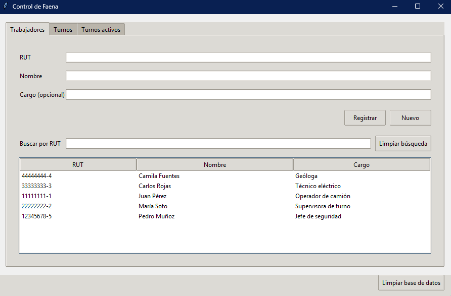
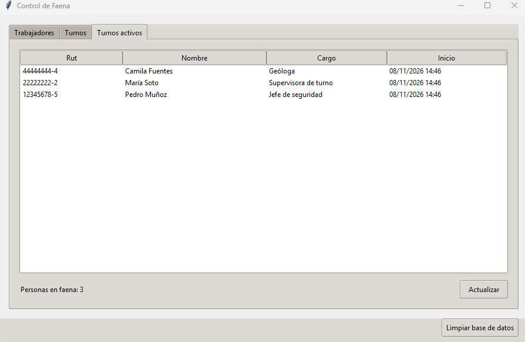
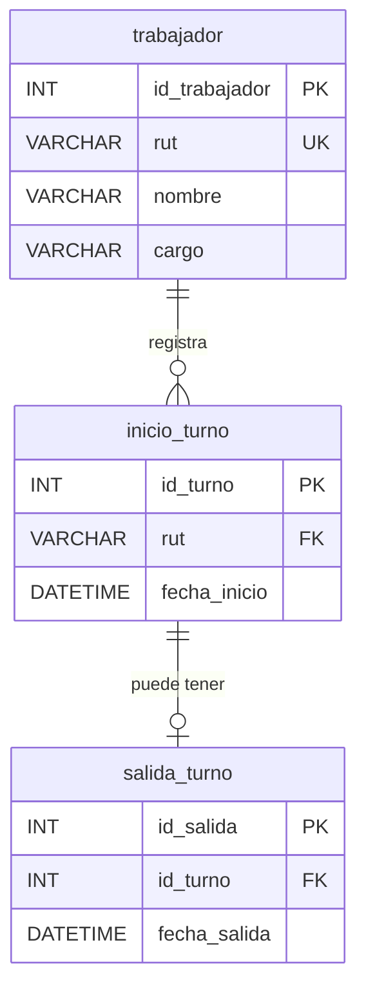

# Control de Faena

Sistema de control de ingreso y turnos del personal en una faena minera,
desarrollado con Python y MySQL. Permite mantener el registro de trabajadores y
gestionar sus turnos desde una interfaz gráfica o un menú de consola.

## Capturas





## Funcionalidades

- Registrar, buscar y editar trabajadores. El RUT se utiliza como identificador
  y no se puede editar.
- Iniciar turnos y registrar la salida del personal.
- Consultar los turnos que permanecen activos.
- Normalizar y validar el RUT chileno, incluido su dígito verificador.
- Limpiar la base de datos con una doble confirmación.
- Usar la aplicación mediante interfaz gráfica con Tkinter o menú de consola.

## Tecnologías

- Python 3.11 o superior
- MySQL
- Tkinter
- `mysql-connector-python`
- `python-dotenv`

## Modelo de datos

El esquema de [src/db/schema.sql](src/db/schema.sql) define las tablas y
relaciones siguientes:



Las longitudes definidas por el esquema son `rut VARCHAR(12)`, `nombre
VARCHAR(100)` y `cargo VARCHAR(50)`; `salida_turno.id_turno` es una clave
foránea única.

Un turno está activo cuando tiene una fila de inicio y todavía no tiene una
fila de salida asociada.

## Estructura del proyecto

```text
src/
├── db/             Conexión, esquema y mantenimiento de la base de datos.
├── repositories/   Consultas y operaciones de persistencia.
├── gui/            Interfaz gráfica con Tkinter.
├── cli/            Menú de consola.
└── utils/          Validación y normalización de RUT.
tests/              Pruebas unitarias.
docs/               Capturas de la aplicación.
```

## Instalación y uso

1. Clona el repositorio y entra en su directorio:

   ```bash
   git clone https://github.com/sebagonza324-glitch/control-faena.git
   cd control-faena
   ```

2. Crea y activa un entorno virtual:

   ```bash
   python -m venv .venv
   ```

   En Windows PowerShell:

   ```powershell
   .\.venv\Scripts\Activate.ps1
   ```

   En macOS o Linux:

   ```bash
   source .venv/bin/activate
   ```

3. Instala las dependencias:

   ```bash
   pip install -r requirements.txt
   ```

4. Copia `.env.example` a `.env` y completa las credenciales de MySQL.

5. Crea la base de datos configurada (por defecto, `control_faena`) y ejecuta
   `src/db/schema.sql` en MySQL.

6. Inicia la aplicación gráfica:

   ```bash
   python -m src.gui.app
   ```

   En Windows también puedes ejecutar `iniciar.bat`. Para iniciar el menú de
   consola:

   ```bash
   python -m src.main
   ```

## Pruebas

Ejecuta las pruebas unitarias con:

```bash
python -m unittest discover -s tests
```

## Decisiones de diseño

- La interfaz y la persistencia están separadas; las interfaces llaman a los
  repositorios y no contienen SQL.
- Las consultas de los repositorios parametrizan los valores de entrada.
- Las credenciales de conexión se cargan desde variables de entorno definidas
  en `.env`; el archivo `.env.example` sirve como plantilla.
- Antes de abrir un turno, el código comprueba que el trabajador no tenga ya
  otro turno abierto.

## Próximas mejoras

- Añadir pruebas automatizadas de integración para las operaciones MySQL.
- Incorporar migraciones versionadas para los cambios del esquema.
- Añadir registro de auditoría para las operaciones de administración.
